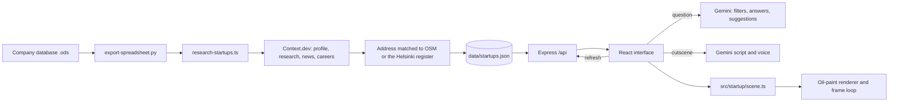
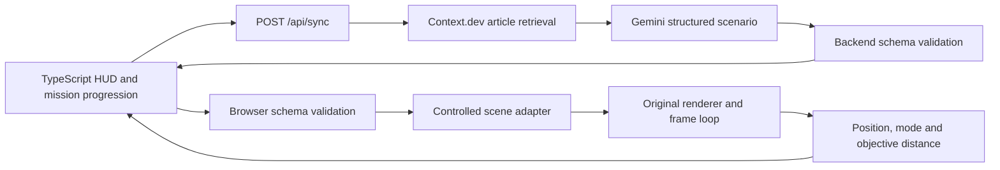

# Startup City: how it fits together

Startup City adds a data layer, a second camera and cutscenes to the oil-painted Helsinki of the earlier WEBWORLD project. The renderer, aurora, map, rider and movement are unchanged. The delivery game that used to sit on top (missions, robots, drones, billboards and its news endpoint) has been removed.

## Scene layer

`public/engine/webworld.js` hands the engine, the map and a per-frame hook to `src/startup/scene.ts`.

- The city view uses the engine's existing free camera and poses it every frame from an orbit (target, distance, yaw, pitch). The projection centre sits low so the northern lights stay in frame. Fog, far plane and draw distance widen while it is active.
- Switching views blends position and look-at between the orbit and the rider's chase camera, then hands control back to the engine. Reduced motion makes this instant.
- Cutscenes switch the scene to cinematic mode: input is ignored and each shot is a scripted move from the orbit plus a slow drift.
- Each startup building gets one additive mesh (walls, roof, a light beam). Its colour and strength follow the company's state. It fades near the camera so street level is not flooded.
- Markers, connection arcs and routes are HTML and a 2D canvas, positioned by projecting world points each frame.
- Picking walks the pointer ray through a grid of building footprints. Routing is A* over the mapped streets and paths.
- Buildings are batched into one mesh per 150 m tile. Trees are drawn only around the point being looked at.

## Data rules

The contract is `src/shared/startup-schema.ts`. Each fact is `{ value, sourceUrl, sourceName, retrievedAt, status }`. A company has a `location` only when its address matched a building. Search filters, mission targets, connections and cutscene scripts are all built from these records, so they cannot show anything the records do not contain.

Gemini sees only the records. Its output is limited to a filter schema, checked suggestion pairs, short answers, or a cutscene script whose camera moves and company ids are validated before playback.

## Interface

The interface follows Google's gemini-frontend-design guidance: one typeface (Google Sans Flex), three body sizes, sentence-case labels, no decorative chips or fake live indicators, brisk transitions on named properties, and reduced motion respected. Colours come from the scene: harbour ink for surfaces and aurora green as the single accent. Hiring, funding and news colours mark real state only. The blue-violet gradient marks content Gemini produced.

---

# Earlier WEBWORLD notes (base engine)

The root application uses the authorized Starry Nightrider client derivative for rendering, movement, camera, terrain, and character animation. Its new scene adapter and TypeScript interface connect that world to the existing WEBWORLD backend.

## Runtime boundary

`public/engine/game.js` runs as a browser ES module after the local service adapters and HUD are installed. A module script loads this static engine in both Vite development and the production build. It imports the captured `kit` and voice-table modules from `public/assets/`.

At the end of initialization, `installWebworld` receives concrete engine references. It publishes `window.__webworldEngine`, dispatches `webworld-ready`, and runs its updates through the original `state.director` hook. There is one renderer and one animation loop.

The interface supports scenario application, target selection, projected marker positions, gameplay snapshots, collection feedback, and delivery rewards. Model output never executes JavaScript. It selects values from the shared scenario schema.

## World

The active geographic renderer is `public/engine/helsinki-real-map.js`. It loads the OpenStreetMap-derived database from `public/data/helsinki/map.json`. `helsinki-geography.js` owns metre projection, polygon tests, a spatial building index and shoreline collision. Visuals, collision and the minimap share source polygons and courtyard holes. `helsinki-citizens.js` uses imported, validated public-path segments for ambient pedestrians.

The original village chunk group is hidden and its streaming stopped. The original controller and camera retain steering, acceleration, jumps, walking, flight, posing and smoothing. Horizontal coordinate warping and vertical world curvature are disabled for geographic fidelity; flat terrain is an explicit remaining approximation. Old village collectibles are hidden so the geographic world does not display invented village landmarks.

`helsinki.js` installs the night palette and Patch aurora; the existing surface shader and postprocessing receive the oil-paint adaptation. `student-scooter.js` retains the custom student model on the original rider rig. `portal.js` still frames the actual live scene and transitions into the same world. The GTA-inspired menu styling is unchanged.

See [the map research and accuracy report](docs/research/helsinki-map.md) for source selection, pipeline, data counts and limitations. The earlier `helsinki-map.js`, `helsinki-landmarks.js` and `helsinki-neighbourhoods.js` are inactive prototype references.

## Missions

The starting Compute Run collects packets at two fixed street positions, then delivers them at a fictional terminal in Rautatientori. All six mission locations are mapped onto accessible streets and plaza positions in `public/engine/webworld.js`. These positions differ from those in the earlier React Three Fiber prototype.

Collection and delivery use a six-unit proximity check while the engine is in ride state. This state supports both scooter riding and walking. Collection increments mission cargo. Delivery requires cargo, completes the mission, and grants a 500-point local reward. Interact steps require R or the touch prompt. Each step advances once. Original trick controls and scoring remain available; the old village collectible meshes are hidden.

Demo sync cycles the existing robot uprising, GPU market crash, and drone breakthrough fixtures. Starting a new scenario replaces the current mission and cargo. Live sync disables the mode control until the request finishes, validates the response, and applies it only on success. A failure leaves mission and scene state intact.

## Providers

Express owns Context.dev and Gemini credentials. The existing server retains bounded requests, cache behavior, shared concurrent syncs, error mapping, and validation. The local service adapter forwards `/api/status` and `/api/sync`, and keeps original multiplayer and original telemetry disconnected.

The browser shows the retrieved article's source and time separately from its fictional mission. Live source URLs must use HTTP or HTTPS. The current implementation uses local generated artwork and original ambient audio. Runtime media generation remains an extension.

## Verification

The 13 unit checks exercise provider parsing and scenario rules. A before/after source comparison verified identical movement/chase-camera, input/scoring and rider-transform implementations. The subsequent portal pass changes entry/return presentation and reduced-motion handling, while the riding movement and chase/orbit camera remain unchanged. `scripts/test-webworld.mjs` exercises the current game through its normal UI and keyboard, including a complete delivery, original movement modes, braking with orbit/zoom, the painting aspect ratio, all three scenario changes, Live errors, validated and invalid API fixtures, shader errors and touch layout. Successful live provider calls require configured credentials and were not verified in this workspace.

`npm run test:portal` verifies frame expansion, live-scene presentation without a photo overlay, HUD timing, full viewport coverage, return/focus restoration, second entry and reduced motion. Optional recording uses `PORTAL_VIDEO=1`.

The district collision regression check runs with `node scripts/test-helsinki-map.mjs`. It covers building interiors, rooftop landing, camera clearance, the first delivery corridor, shop/park access and perimeter walls.

## Geographic verification

`node scripts/test-helsinki-map.mjs` checks source landmark coordinates, named roads, land/sea classification, building collision, courtyard triangulation, the introductory delivery corridor and all imported citizen routes. Source height provenance remains in the shipped data. Browser tests verify the mission and controls after activating metre coordinates.

## Oil-paint rendering boundary

`public/engine/oil-paint/surface.js` wraps the engine's material factory before scene
construction. The eight-mark brush atlas comes from Patch; UV-anchored pigment and
height-based relief cover the existing meshes. Billboards keep a separate readable
text material. `foliage.js` batches world-pinned brush cards by geographic tile.

`aurora.js` installs the reference sky into the same scene, renderer, camera and
frame loop. The adapted sources in `oil-paint/reference/` retain the original
curtain motion, stars, layered rays and noise. `three.js` maps imports to existing
engine types; dab geometry is expanded into vertex buffers because this engine's
public module does not expose instancing types. The sky shell is reduced to 1,200
metres to fit the existing camera far plane; angular placement is preserved. Night
wash intensity is compensated for the game's existing filmic/sRGB finish.

Reduced motion holds the aurora's clock at a fixed time. Demo mood changes alter
night lighting and aurora strength without switching back to daytime. Physics,
ride/walk/flight transforms, camera smoothing, geographic coordinates and provider
services are unchanged. The title camera alone is reframed to show the aurora.

`src/webworld/oil-paint.css` owns the dark linen menu treatment. The existing GTA-like
lettering and portal timing stay in place. See the shipped MIT notice and provenance
in `public/engine/oil-paint/NOTICE.md`.
