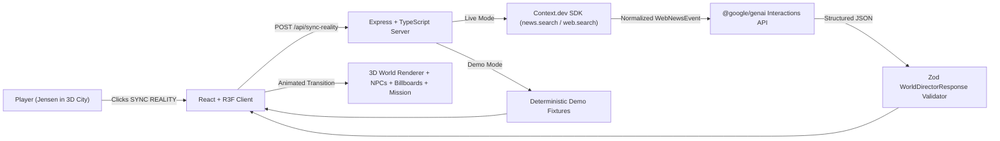

# WEBWORLD — Architecture & Game Design Document (`Design.md`)

## 1. Core Vision

**Premise:** *"What if the internet was a video game?"*

Inspired by the spirit of interactive world models — without attempting slow, unstable mesh generation at runtime — **WEBWORLD** pairs a responsive, procedural 3D cyberpunk city with **Google Gemini** acting as a live **AI Game Director** and **Context.dev** acting as the game's **Live Internet Sensor**.

---

## 2. Three-Track Modular Workspace Organization

The repository uses npm workspaces (`shared`, `server`, `client`) cleanly divided into three parallel developer tracks:

### Track 1: Game Engine & Cyberpunk HUD (`client/src/`)
- `game-engine/WorldCanvas.tsx`: R3F WebGL canvas with `ACESFilmicToneMapping` and soft `PCFShadowMap` shadows.
- `game-engine/CityBuilder.tsx`: 3x3 urban cyber-grid, wet reflective asphalt, sidewalks, central Tensor Hologram Plaza, 14 procedural skyscrapers with canvas-generated lit windows (`SRGBColorSpace`), and **6 dynamic 3D canvas billboards** displaying live ticker & headline text.
- `game-engine/JensenCharacter.tsx` & `PlayerController.tsx`: Stylized Jensen Huang in a glossy clearcoat black leather biker jacket, silver hair, rectangular glasses, and back-mounted golden GPU wafer. Features camera-relative WASD + Sprint + Jump, circle-vs-AABB building collision, raycast camera push-in, frame-rate-independent exponential camera smoothing (`1 - exp(-rate * dt)`), and trauma-based screen shake (`trauma^2 * summed sines`).
- `game-engine/NpcSystem.tsx`: 16 citizens reacting to `npc_mood` (`calm`, `panic`, `celebrate`, `protest`, `awe`) + up to 18 bipedal Rogue AI Robots using a patrol/chase FSM with distance hysteresis (`enter: 15m`, `exit: 22m`) to prevent state flicker.
- `game-engine/TrafficAndDrones.tsx`: 12 neon cyber-cars supporting `normal`, `chaos` (2.35x speed + sinusoidal swerving + red underglow), `gridlock`, and `hyperloop` modes + up to 14 orbiting quad-rotor Sky Drones with volumetric light cones.
- `game-engine/WorldEnvironment.tsx` & `MissionBeacon.tsx`: Smooth color/fog interpolation across 6 atmosphere palettes, rotating emergency sirens, expanding 3D reality-sync shockwave ring, particle weather (`digital_rain`, `ember_sparks`, `data_snow`), and interactive 3D Landmark Mission Beacons.
- `ui/`: Event-driven Zustand HUD (`TopBar`, `MissionTracker`, `LiveInternetPanel`, 60Hz canvas `Minimap`, `DialogueToast`, `AiDebugDrawer`) using `playerTelemetry` refs so 60 FPS gameplay never forces React HUD re-renders.

### Track 2: AI World Director (`server/src/ai-director/` & `shared/src/schemas/world.ts`)
- `geminiClient.ts`: Built on `@google/genai` (`v3.3.0`) **Interactions API** (`client.interactions.create`), passing `system_instruction`, `generation_config: { thinking_level: 'low', max_output_tokens: 32768 }`, and `response_format: { type: 'text', mime_type: 'application/json', schema }`.
- **Zero Arbitrary Code Execution**: Gemini can only choose from bounded, enumerated engine parameters (`event_type`, `sky_color`, `spawn_robots` `0..18`, `spawn_drones` `0..14`, `traffic_mode`, `npc_mood`, `weather_effect`, `emergency_lights`, and 6 known `LandmarkId` targets).
- `validator.ts` & `scenarioGenerator.ts`: Enforces strict Zod validation (`WorldDirectorResponseSchema`), clamps numeric ranges (`sanitizeWorldDirectorResponse`), applies per-call timeouts, and retries once with `gemini-3.5-flash-lite` on transient model failures.

### Track 3: Live Web Integration (`server/src/live-web/` & `shared/src/schemas/news.ts`)
- `contextClient.ts`: Uses the official `context.dev` SDK (`v3.29.0`), querying `client.news.search` first (entity ticker search for `NVDA` and natural-language news search for AI/GPU/Tech topics) with automatic fallback to `client.web.search` (`freshness: 'last_week'`).
- `normalizer.ts`: Strips markdown noise, extracts publisher hostname/name, normalizes ISO timestamps (`publishedAt` and `retrievedAt`), deduplicates URLs, and tags every live record with `provenance: 'live_web'`.
- `eventCache.ts`: 3-minute TTL topic cache with MRU event rotation so consecutive `SYNC REALITY` clicks surface fresh stories.

---

## 3. Key Technical Decisions

1. **Verified Gemini SDK & Model IDs**: Per the official `gemini-api-dev` skill, legacy `generateContent` and `gemini-1.5/2.0/2.5` models are avoided. Default fast generation uses `gemini-4-hydrogen` (with `gemini-3.5-flash-lite`, `gemini-4-carbon` Pro-tier, and `gemini-3.8-flash` active legacy selectable in the HUD and `.env`). Deprecated model IDs are automatically substituted with a transparent warning.
2. **Strict Provenance & Anti-Spoofing Schema**: `WebNewsEventSchema` uses Zod `superRefine` to enforce at the schema level that `simulated_demo` events have `sourceUrl: null` and `live_web` events have a valid `https://` `sourceUrl`. Failed Live Mode requests return structured `ApiErrorResponse` payloads and **never** silently fall back to mock news labeled as live.
3. **React Three Fiber Skill Binding Note**: Three.js lighting, shadow frustum fitting, `ACESFilmicToneMapping`, and `SRGBColorSpace` canvas textures follow `threejs-materials-lighting` (`r187` PBR conventions), bound idiomatically onto `@react-three/fiber` v9 + `@react-three/drei` v10.

---

## 4. Future Extensions (Post-Hackathon)
- **Live Billboard Art Generation**: Wire `director.asset_prompts.billboard_image_prompt` to `gemini-nano-banana-2.1` asynchronously in the background to swap billboard textures once generated without blocking mission start.
- **Breaking-News Cutscene Clips**: Wire `director.asset_prompts.cutscene_video_prompt` to `gemini-omni-1.2-flash` for optional news-broadcast PIP clips.
- **Voice Comms**: Use `gemini-3.8-flash-lite-tts` to voice street NPC panic lines and Jensen one-liners.
