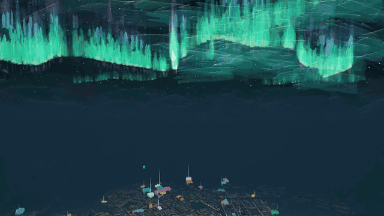
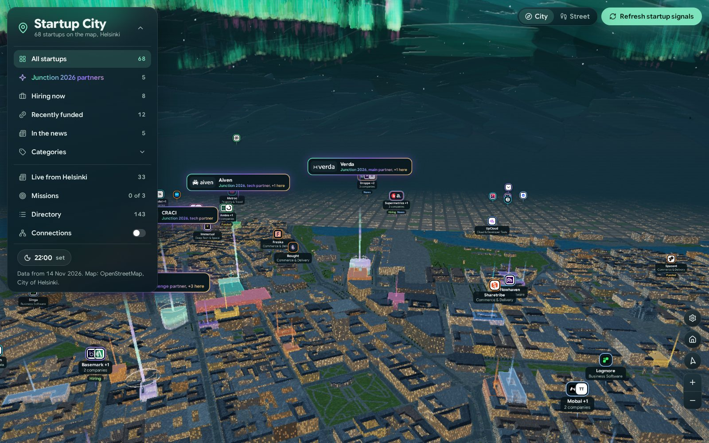
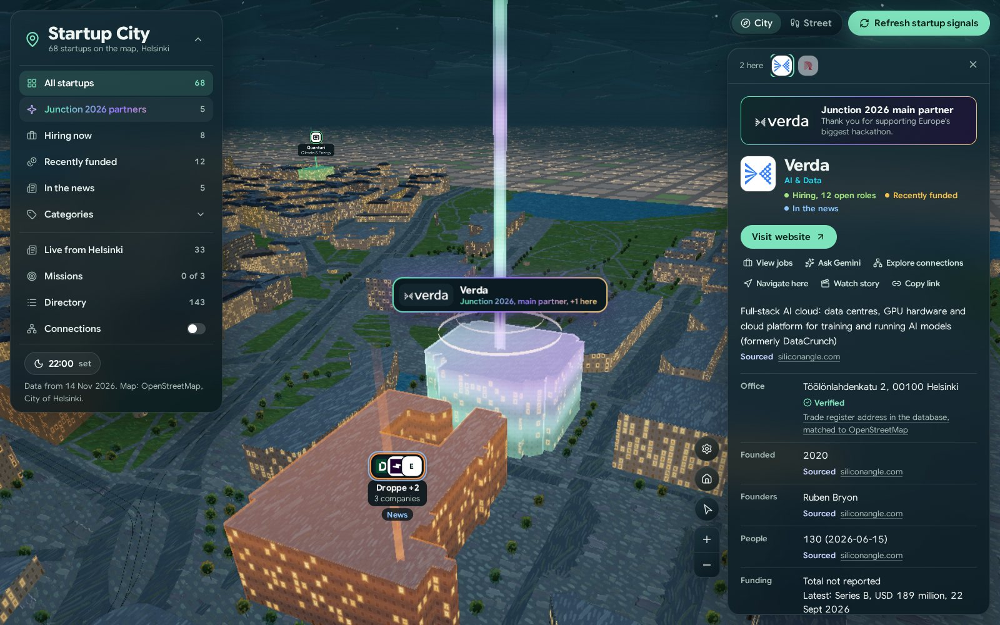
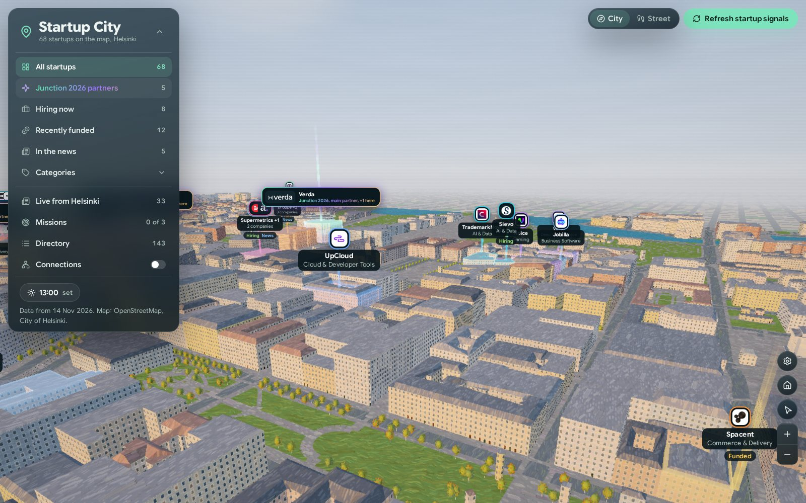
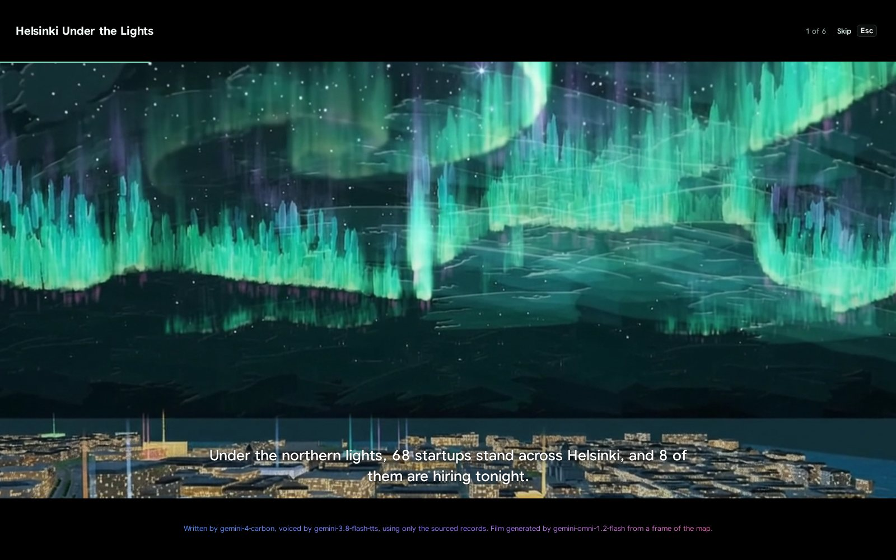
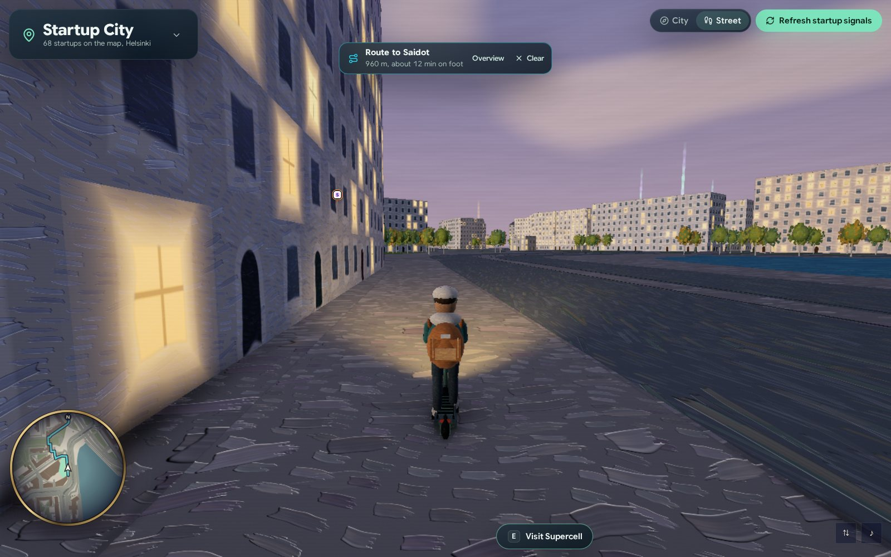
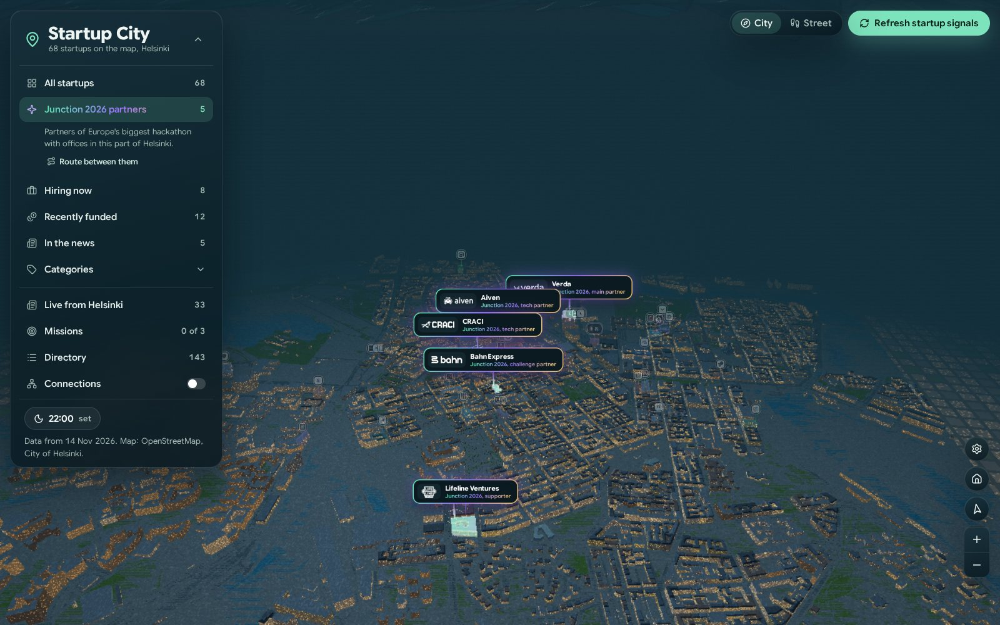
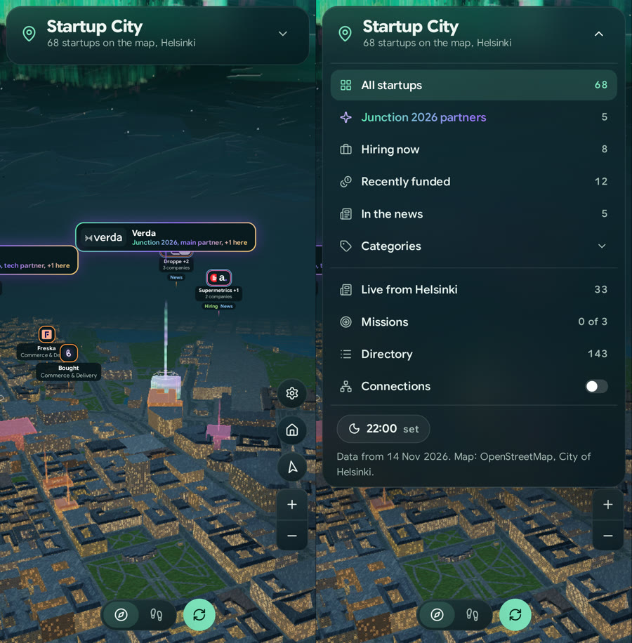
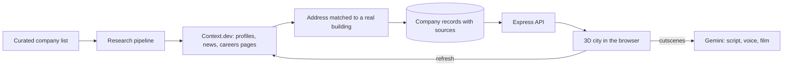

# Startup City

**Helsinki's startup scene as a living 3D city.** Fly over Helsinki under the northern lights, see every startup at its real address, and find out in one click who they are, whether they are hiring, and what was published about them this week.



<sub>The opening flight, recorded in the app. [Full quality clip](docs/images/hero.webm).</sub>

Built at **Junction 2026** for the Context.dev challenge, *The Web Is Your Real-Time Database*.

## Why

Startup directories are spreadsheets. They do not show you that six AI companies share one building in Ruoholahti, that a company two streets from your office raised a round on Thursday, or which teams around you are hiring right now. People new to Helsinki, investors in town for Slush and students looking for their first job all have the same question: *what is being built here, and where?*

Startup City answers it as a place you can explore instead of a list you scroll.

## What you can do

| | |
|:---:|:---:|
|  |  |
| **Explore the city.** 143 Helsinki startups, 66 placed on their real buildings. Drag, zoom and turn like a web map. | **Open any company.** Description, founders, funding, investors, open roles and news, each with its source. |
|  |  |
| **Day and night.** The sun follows its real path over Helsinki. Facades by day, the northern lights after dark. | **Watch the news.** Gemini writes and voices short cutscenes from the records: an intro, a morning briefing, a company story. |
|  |  |
| **Go to street level.** Ride or walk to a startup with a route on the minimap. | **Meet the partners.** All 39 Junction 2026 partners, with five offices on the map. |

There are also filters for hiring, recently funded and in the news, a live news feed, connections between companies (shared investors, joint announcements), three discovery missions, and a guided 90 second tour for demos. It works on phones.

<p align="center"></p>

## Try it in a minute

You need [Node.js](https://nodejs.org) 22.12 or newer.

```sh
git clone https://github.com/Namprire/WorldWeb.git
cd WorldWeb
npm ci
npm run dev
```

Open <http://127.0.0.1:5179> and press **Explore the city**, then **Take the 90 second tour** for the guided demo.

It runs without API keys on the saved data in the repository. To fetch live news and open roles and to generate new cutscenes, add your own keys:

```sh
cp .env.example .env    # then set CONTEXT_DEV_API_KEY and GEMINI_API_KEY
```

To try it on a phone on the same Wi-Fi, run `npm run dev:phone` and open `http://<your computer's IP>:5179`.

| Where | How |
| --- | --- |
| City view | Drag to move, scroll or pinch to zoom, right-drag to turn, click a glowing building |
| Street level | W A S D to ride, F to walk, E to visit the startup in front of you |
| Anywhere | Tab switches view, ? lists every shortcut, Esc closes |

## How it works



- **The city** is built from OpenStreetMap footprints and streets, with heights, ages and facade materials from the City of Helsinki building register: 2,736 buildings, painted in oils.
- **The companies** come from a curated list of Helsinki startups. [Context.dev](https://context.dev) reads each company's profile, its own careers page and published news. A company is placed on a building only when its registered address matches that building.
- **Every fact has a source.** Profiles mark each value as Verified (read from the source), Sourced (taken from a cited page) or written by Gemini. Missing facts stay empty; nothing is guessed.
- **Gemini** answers questions from a company's record only, suggests connections (labelled as suggestions), writes and voices the cutscenes, and Gemini Omni Flash generated the establishing films.

More detail: [architecture](docs/ARCHITECTURE.md) and [data and sources](docs/DATA.md).

## Built with

React, TypeScript and Vite for the interface, a WebGL oil-paint renderer for the city, Express on the server, Context.dev for company data, and Gemini 4 (Hydrogen, Carbon, Argon), Gemini TTS and Gemini Omni Flash for language, voice and film.

## Repository

| Path | What is in it |
| --- | --- |
| [`src/startup/`](src/startup) | The interface: map scene, sidebar, profiles, cutscenes |
| [`server/`](server) | API: Context.dev research, Gemini, cutscenes |
| [`public/engine/`](public/engine) | The 3D renderer: oil paint, aurora, day and night, map |
| [`data/`](data) | Company records, partner list, cached cutscenes |
| [`scripts/`](scripts) | Map build, research pipeline, film generation, tests |
| [`docs/`](docs) | Architecture, data sources, screenshots |

```sh
npm test                 # unit tests
npm run build            # type check and production build
npm run test:browser     # browser tests, with the dev server running
npm start                # production server on port 8787
```

## Credits

Map data © [OpenStreetMap](https://www.openstreetmap.org/copyright) contributors (ODbL). Building heights, ages and materials: City of Helsinki building register (CC BY 4.0). Company information retrieved through Context.dev from public sources. Partner list and logos from the [Junction 2026](https://2026.hackjunction.com/) site. Company names and logos belong to their owners. Oil-paint rendering adapted from [Patch's oil-paint](https://patch.gg/blendi/oil-paint) (MIT, see `public/engine/oil-paint/NOTICE.md`). Interface font: Google Sans Flex (SIL Open Font License).
