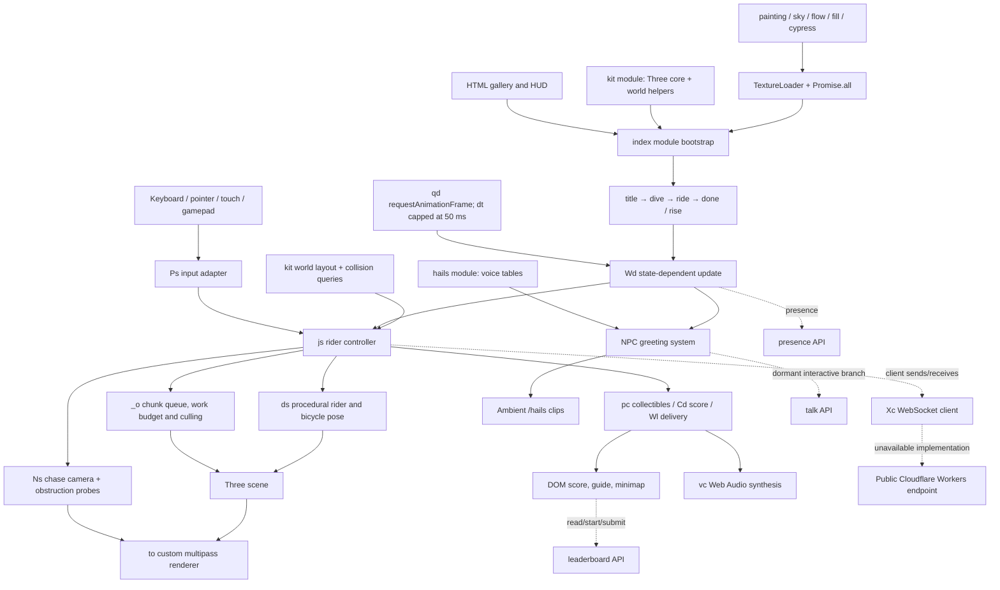
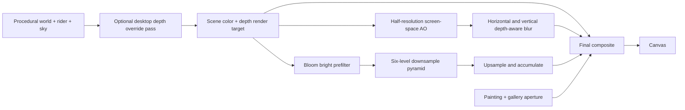
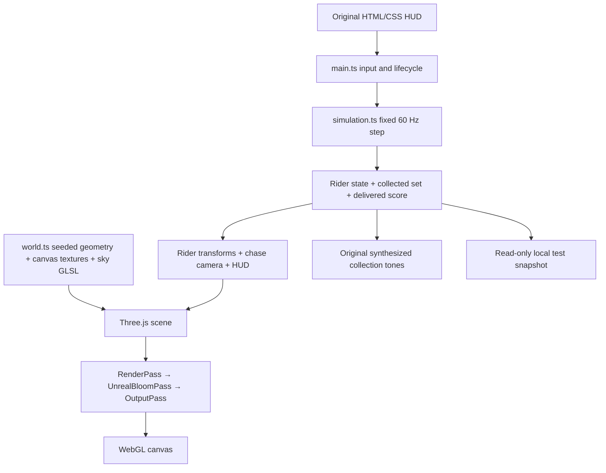

# Architecture analysis

**Follow-up:** [reproduction-report.md](reproduction-report.md) documents the later user-authorized local execution of the original client and the new TypeScript API adapters. The independent prototype diagram below still describes `prototype/`.

Study date: 14 November 2026 (Europe/Helsinki). Scope: the public desktop build captured from [starrynightrider.com](https://starrynightrider.com/). Names below are **shipped minified symbols**, not recovered original module names. Line numbers refer to the locally formatted analysis copies; byte hashes refer to `evidence/raw/`.

## Evidence notation

- **S**: static inspection of the shipped client. Establishes what the client contains, not whether every branch is active.
- **R**: observed browser behavior, resource response or WebGL call.
- **H**: hypothesis or architectural inference.
- **U**: unavailable or untested.

## Public client

The graph is a reconstruction of relationships visible in this build. It is not a claim about the author's repository layout, framework configuration, or server internals.

## Module and function map

| Area | Shipped symbol and formatted location | Evidence and interpretation |
|---|---|---|
| Renderer | `na`, main module before line 14071 | S/R: bundled Three WebGLRenderer implementation; WebGL 2 context observed. |
| Three revision | `kit` line 9797 | S: runtime marker sets `window.__THREE__` to `187`. Package lock/build provenance unavailable; marker is not proof of an unmodified npm release. |
| Shared material uniforms | `ra()`, main line 14071 | S: time, bend center, fog, moon/ambient/warm colors, headlight and painting texture shared across renderers. |
| Sky | `va()`, line 14660 | S/R: fullscreen triangle with inverse camera projection, painting/flow/fill samplers, animated stars. Runtime GLSL captured. |
| Hills / painting transition | `Na()` line 14937, `Ka()` line 15254 | S: world backdrop and painting/cypress projection materials. Cypress mask participates in fragment discard. |
| Postprocessing | `to` class, line 15650 | S/R: custom render targets and explicit fullscreen passes; not evidence of a third-party effect-composer package. |
| Material variants | `io()` 16719, `ao()` 16752, `co()` 16891 | S: painted, depth, and glow materials; dynamic and NPC-walker variants. |
| World streaming | `_o` class, line 16932 | S: chunk map, construction queue, near-detail queue, reusable geometry builders, frustum/culling work. Chunk work is time-budgeted. This is not a conventional downloaded level mesh. |
| Player model | `ds()` line 18257 and preceding geometry helpers | S/R: procedural bicycle and body geometry, pose interface, limb/wheel/scarf/wing state. No GLTF or FBX response in the tested route. |
| Movement | `js` class, line 18914 | S: custom kinematic controller, ground probes, roof/interior constraints, wall avoidance, walking and flight. No identified Rapier/Cannon/Ammo dependency in inspected paths. |
| Camera | `Ns` class, line 19588 | S: smooth heading, velocity/flight-dependent distance and FOV, obstruction samples, lift and shake. |
| Inputs | `Ps()` line 19695 | S: key sets, pointer capture for drag-look, wheel zoom, touch and gamepad handling. Mouse-look is drag based; pointer lock was not identified in this adapter. |
| Collectibles/routes | `pc()` line 20533 | S: route targets, trails, strays, prisms and interior course state. |
| Sound | `vc()` line 20974 | S: AudioContext, oscillators, buffers, noise/convolution and event sounds. Ambient voices separately use HTML Audio and MP3. |
| Map / prism displays | `kc()` 21382, `Ac()` 21730 | S: HUD map and collectible presentation. |
| Presence | `Mc()` line 21794 | S/R: periodic POST attempted; test blocked it. 15-second interval and page-hide beacon visible statically. |
| Multiplayer | `Xc()` line 21890 | S/R: WebSocket constructor attempted; packets/handlers statically readable. Instrumented run did not connect to the server. |
| Ambient and interactive speech | `pl()` line 22479 | S/R: nearby speech/MP3 playback. `/api/talk` exists in code, but the main bootstrap disables R/click interaction in this build. |
| Leaderboard | `Rl()` line 22860 | S/R: GET response observed; POST start-token attempts blocked. Score form posts only through a separate submission action, which was not exercised. |
| Bootstrap/asset loading | main lines 23198–23300 | S/R: creates renderer, scene, camera; awaits five image textures; builds world, model, controllers. |
| Entry/exit | `Hu()`, `Ku()`, `qu()`, `Xu()` | S: title dive, return rise, title reset, finish flow. Dive reaches ride after about 8.35 simulation seconds. |
| Scoring orchestration | `Cd()` line 23948; `sd()` line 23743 | S: updates orbs, multipliers, tricks, deliveries, hyper meter, HUD and sound. |
| Update/render loop | `Wd()` 24308, `qd()` 24482 | S/R: state dispatch, movement/model/gameplay/camera, chunk work and rendering. Adaptive pixel resolution responds to measured frame time. |

## Rendering pipeline

**S:** the final shader has exposure, bloom, saturation, contrast, outline, vignette, title mix and rush controls. World vertices use a shared camera-relative vertical bend. NPC poses are partly calculated in a vertex shader from per-vertex body-part/action attributes. Lamp data and a moving bicycle light feed painted materials. A static title fast path composites the painting without rerendering the full scene. **R:** 36 `shaderSource` calls were recorded across title/ride/actions; this is not 36 unique authored shaders or a complete GPU program count.

## Mechanics and camera

**S:** the original targets a cruising bicycle speed of 8.2 logical units/s, a pedal speed of 15.5, and a flight target of 15/25 depending on throttle, before boost and constraints. Typical grounded acceleration is 5.2 units/s² and braking is 11. The `ms` gravity-related constant is 19; held-jump and flight branches modify vertical acceleration. The jump impulse constant is 9.4. Horizontal displacement is subdivided into steps no larger than approximately 0.3 logical units. These are code-level values, not independently calibrated real-world meters.

**S:** three Space presses inside 1100 ms enable wings, subject to current mode. F toggles walking only in eligible grounded state. On-foot movement includes reverse/braking, running, wall scramble and kicks; aerial trick evaluation checks landing orientation and combinations. Riding uses lane/heading assistance. These advanced behaviors are not all reproduced by the prototype.

**S:** the camera smooths heading, expands distance in the air, tests the route from rider to camera for obstructions, lifts/retracts when blocked, and adds landing shake. Ride FOV is based on a 72° baseline plus speed/air/boost terms. Drag-look and wheel zoom affect framing. Entry uses a cubic Bézier path and projection adjustment to move from the framed painting into the world.

**R:** screenshots confirm entry transition, riding scene, changed facing after steering, visibly airborne winged rider after triple tap, and theater display. The walking capture is only a key attempt: it still shows a bicycle, so this study does not count that screenshot as a successful original walking transition. Camera/movement constants above are static findings, not measurements fitted from pixels.

## Entity and asset organization

**S/H:** Three scene graph objects plus bespoke arrays, Maps and controller objects form the entity organization. No evidence supports calling it an ECS framework. Streets, houses, plants, people and rider parts are assembled by procedural geometry builders, while a small image set supplies painting-derived appearance. Five boot textures load concurrently; nearby geometry is generated incrementally. The main file contains both engine code and application code, so its whole byte size must not be attributed to custom game logic.

**H:** Vite or a compatible bundler likely produced the ES modules: hashed `/assets/` filenames, module preload links and the preload polyfill fit that toolchain. The original build system and authoring language remain unverified. No evidence in this capture establishes React, React Three Fiber, Unity, Babylon, a model editor, or an original TypeScript project.

## Server boundary

The public WebSocket URL is in `kit` line 9812. Its hostname is a Cloudflare Workers address; this identifies the endpoint host, not its storage or server design.

**S:** the client sends a 13-element state array at roughly 5 Hz when active. Incoming rider arrays include identity/color/age plus state; snapshots are interpolated with a 0.35-second presentation delay and limited extrapolation. The client pools at most eight remote rider models on desktop (five on touch), carries older samples, and removes stale riders. Message handlers cover identity, state snapshots, bumps, speech, score loss/transfer and loose orbs. Joining is deferred by time/distance from spawn. No invented or modified packets were transmitted.

**U:** authority over position, collision adjudication, score validation, anti-cheat, rate limits, storage, moderation, room partitioning and deployment logic cannot be recovered from the client alone. The leaderboard client requests a session token before score submission; its server checks are unknown. Presence counters are not proof of simultaneously visible players. Interactive speech code does not establish that an AI service is enabled or which provider powers it.

## Independent prototype architecture

This uses Three.js **0.185.0**, Vite **7.3.8**, and TypeScript **5.9.3** from npm. It does not import any target bundle, shader, texture, audio clip or geometry. The world is finite and simpler; collisions are axis-aligned boxes, the terrain is flat, idle coasting slows to a stop, scoring is local and the only delivery target is a single steeple. Source-level inspection informed the functional specification, so this is independently authored code, **not a formal separated-team clean-room process**.
