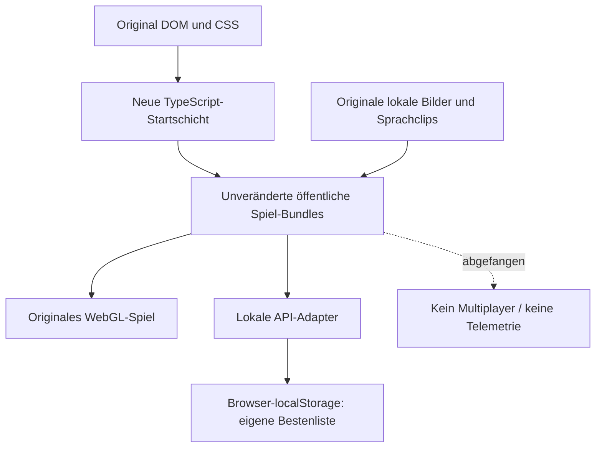
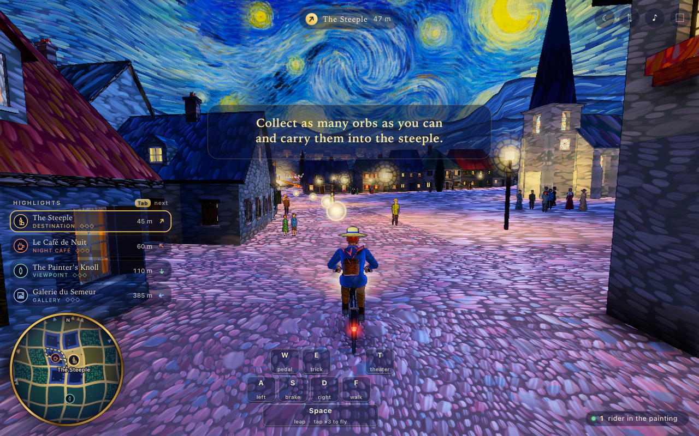

# Nachtrag: autorisierte lokale Reproduktion

Der erste unabhängige Prototyp erfüllte die gewünschte visuelle Übereinstimmung nicht. Nach der ausdrücklichen Bestätigung des Nutzers, zur Wiederverwendung von Originalcode und bearbeiteten Grafiken berechtigt zu sein, wurde ein zweiter Ausführungsweg unter `reproduction/` erstellt.

## Ergebnis

Der originale öffentliche Produktionsclient läuft lokal, einschließlich ursprünglichem Three.js-Renderer, Materialien, Shadern, prozeduralem Dorf, Fahrrad/Figur, Kamera, Flug, Gehen, Sammelmechanik, UI und Audio. Die drei Spielmodule und das Stylesheet stimmen bytegenau mit der erfassten Auslieferung überein. Die erneut abgerufene aktuelle HTML-Seite stimmt ebenfalls bytegenau mit der vorherigen Erfassung überein und referenziert dieselben Modulnamen: siehe `evidence/reproduction/current-deployment-check.json`.

Alle 120 Originaldateien wurden in `reproduction/asset-manifest.json` mit URL, Größe und SHA-256 erfasst. Bereits gesicherte Bytes wurden wiederverwendet. Nur die explizit referenzierten zusätzlichen Bilder und Sprachclips wurden mit normalen, seriellen HTTPS-GETs geladen; es gab keine Verzeichnissuche oder Abfrage privater Dateien. Alle 108 referenzierten Sprachclips konnten geladen werden.

## Technische Änderungen

Die neue TypeScript-Datei `reproduction/src/main.ts` lädt das ursprüngliche Hauptmodul dynamisch und stellt zuvor lokale Adapter bereit. `index.html` verwendet diesen Einstieg, ergänzt eine restriktive Content Security Policy und kennzeichnet die Bestenliste als lokal. Das ursprüngliche Spiel-Markup und Stylesheet bleiben ansonsten erhalten. Die Spiel-Bundles selbst wurden nicht gepatcht oder neu übersetzt.

Der lokale Adapter implementiert keine Authentifizierung des Originaldienstes. Sein Score-Startwert ist ausdrücklich ein lokaler Platzhalter und wird nie an die Website übertragen. Netzwerkzugriffe auf die ursprünglichen Dienste werden nicht benötigt. Bestehende Online-Scores, Spielerkonten und andere Nutzer werden nicht berührt.

## Bildvergleich

Die frühere grobe Nachbildung ist zum Vergleich unter `revisions/v1/prototype-ride.png` erhalten. Die neue Aufnahme zeigt die tatsächlich vom Originalclient gerenderte Szene. Für die Galerie wurde zusätzlich ein Bildvergleich bei 1280×800 angelegt: `evidence/reproduction/visual-comparison.json`. Die Aufnahmen haben unterschiedliche Animationszeitpunkte; insbesondere CSS-Lichtverläufe und der Beginn der Darstellung können differieren. Deshalb wird weder ein pixelgenau identisches bewegtes Spiel noch eine pauschale „100 %“-Ähnlichkeit behauptet.

## Abgrenzung zu den bisherigen Berichten

`reverse-engineering-report.md`, `architecture.md` und `feasibility-matrix.md` dokumentieren weiterhin die ursprüngliche Analyse und den **unabhängigen Prototyp**. Dessen frühere Performance- und Ähnlichkeitszahlen gelten nicht für diese Reproduktion. Die unveränderten ursprünglichen Bundles ersetzen hier den Nachbau; ein originales Quellcodeprojekt wurde dadurch nicht zurückgewonnen.

Nicht enthalten sind die echten Serverdienste: Multiplayer, globale Bestenliste, Presence-Datenbank, serverseitige Validierung, Moderation und interaktive Gespräche. Es gibt eine lokale Bestenliste sowie einen lokalen Spieler. Die normalen NPC-Sprachclips und sonstige clientseitige Spielmechanik bleiben verfügbar.

## Validierung

`reproduction` besteht die TypeScript-Prüfung und den Vite-Produktionsbuild. Alle **15 endgültigen Prüfungen** in `evidence/reproduction/checks.json` sind bestanden; Screenshots belegen Galerie, Fahrt, Gehen und Flug. Der Test prüft auch, dass das Spiel ausschließlich lokale HTTP-Ressourcen lädt und keine tatsächliche WebSocket-Verbindung öffnet. Der erste Testlauf zeigte, dass allein das Verkleinern eines Desktopfensters nicht den Touch-Zweig aktiviert; der Mobiltest wurde auf einen echten emulierten Touch-Kontext umgestellt. Dies war eine Korrektur des Tests, keine Änderung des Originalclients.

Startanleitung: [reproduction/README.md](reproduction/README.md).
