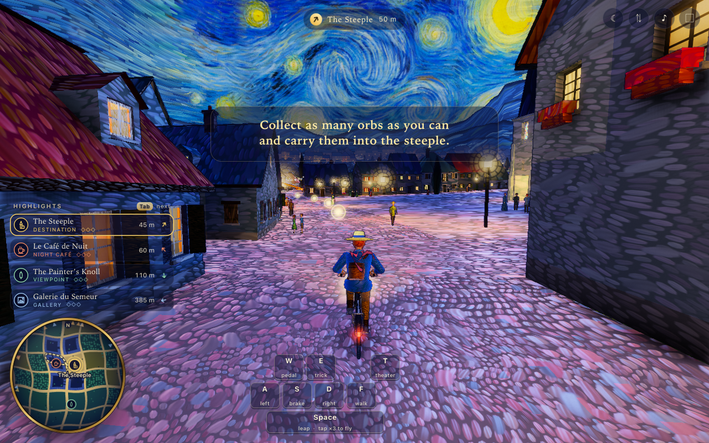
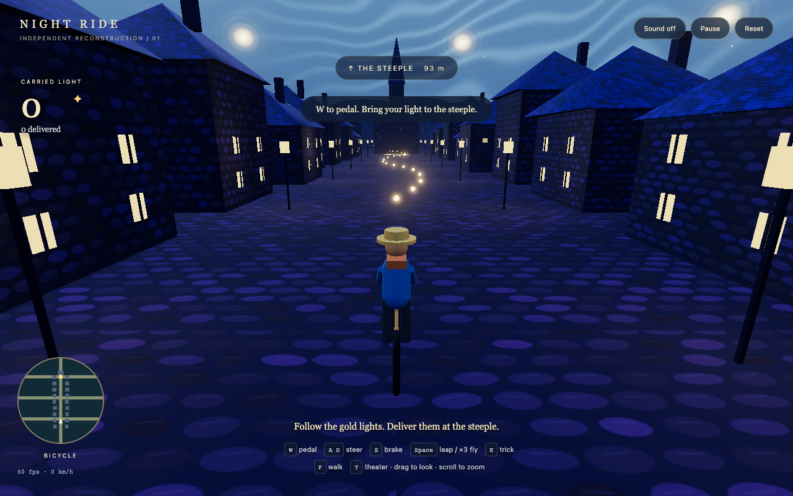

# Starry Nightrider: public-client feasibility study

**Follow-up:** the user subsequently confirmed permission to reuse the original client and assets. The new [local reproduction](reproduction-report.md) runs that public client under `reproduction/`. The prototype measurements and visual comparisons below describe the earlier independent implementation, not the new reproduction.

**Result:** an independently authored, locally runnable approximation of the core single-player loop is feasible. The public client exposes enough detail to analyze rendering, procedural geometry, movement, camera, input, scoring and network-client structure. Exact source-project recovery is not established. The original server implementation remains unavailable, and the prototype is visibly much simpler than the game.

Target: [https://starrynightrider.com](https://starrynightrider.com/). Capture: **14 November 2026, 03:45 EET** (`2026-11-14T01:45:41.030Z`). Evidence describes this deployment only. A later visit may serve different hashes or behavior.

## Scope and method

1. Opened the public page in Chrome through browser tools, inspected accessibility/DOM and screenshots, and entered the game through its visible button. The ordinary visit displayed the gallery, then a painted 3D village and rider HUD. No chat, form, leaderboard-score submission or deliberate rider contact was performed. Normal client presence/network behavior was not intercepted during that first short visit; it was then closed.
2. Retrieved the HTML and its explicitly referenced three JavaScript modules and stylesheet with normal HTTPS requests. Saved canonical raw responses separately from formatted analysis copies. An initial Python HTTPS request failed due to that interpreter's local CA configuration; system curl and Chrome succeeded with normal certificate verification. No TLS checks were disabled.
3. Ran an isolated Playwright Chrome session at 1280×800, DPR 1. Blocked every non-GET/HEAD HTTP request and intercepted all WebSockets without forwarding them to the server. Used ordinary UI/keyboard input to examine entry, pedaling, turning, jump attempt, walk attempt, flight and theater. This avoids collisions or score effects on other players during testing.
4. Recorded response URLs/status/type/size where available, navigation/resource timing, JavaScript exceptions, screenshots and HUD text. Instrumented `getContext`, `shaderSource` and `texImage2D`, plus an independent rAF timestamp sampler. Saved raw public assets for analysis only. API response bodies and WebSocket user payloads were not retained.
5. Checked three conventional `.js.map` companions, once each. They returned 404. No `sourceMappingURL` directives were found in those modules. Checked HEAD metadata for two explicitly referenced small-device images, the social preview and three already-observed voice clips. Did not scan directories or probe private paths.
6. Wrote the prototype from original TypeScript, GLSL, HTML and CSS. Procedural geometry and generated Canvas textures replace target art; simple synthesized tones replace target sound. Built and tested it locally.

An initial instrumented run was interrupted after its title capture, then restarted. The retained `network.json` and runtime metrics belong to the completed second run. There were no crawling loops or load tests; the site received a small number of normal page loads, explicitly linked asset requests and nine bounded metadata/source-map checks, plus ordinary browser-triggered requests. The study is not a complete crawl of every possible game mode.

## Evidence and reproducibility

| Record | Contents |
|---|---|
| [asset-inventory.csv](asset-inventory.csv) | Network resources, explicit derived audio references, metadata checks, APIs and captured inline shaders; unknown sizes remain blank |
| [architecture.md](architecture.md) | Diagrams, shipped symbol map, rendering/input/gameplay analysis and server boundary |
| [feasibility-matrix.md](feasibility-matrix.md) | Feature evidence, confidence, implementation status and remaining experiments |
| [evidence/network.json](evidence/network.json) | 33 responses, six blocked HTTP writes, one intercepted WebSocket attempt, zero uncaught JS exceptions |
| [evidence/runtime.json](evidence/runtime.json) | WebGL hooks, GLSL strings, texture upload metadata, rAF intervals, timing and heap snapshot |
| [evidence/observations.json](evidence/observations.json) | Timestamped action labels and HUD text; labels denote attempted actions, not assertions of success |
| [evidence/source-map-checks.json](evidence/source-map-checks.json) | Exact tested URLs, status, response bytes and directive checks |
| [evidence/measurements.json](evidence/measurements.json) | Derived metrics with definitions and environment |
| [evidence/prototype-checks.json](evidence/prototype-checks.json) | 11 successful browser checks and local-only request list |
| [scripts/](scripts/) | Reproducible inspection, browser verification and offline analysis |

Raw downloaded target files are in `evidence/raw/`; formatted `.js` copies are in `evidence/`. These are inspection records, **not original repository source**, and are never imported by the prototype. SHA-256 checks identify the exact bytes inspected. The three application modules total **900,003 decoded bytes**: main 599,650; kit 293,030; hails 7,323. The retained static network bodies total **4,012,757 bytes**, including images and the downloaded analytics script. This total excludes bodies not retained, so it is not the full session's network cost.

## Established findings

**Observed runtime:** WebGL 2 is active. The gallery opens into a third-person bicycle view among painted buildings, lamps, trees, townsfolk and glowing collectibles. Pedaling/turning changed the view and carried-score display. Triple tapping Space produced a visibly winged airborne rider; theater hid gameplay overlays. The single captured F attempt did not conclusively demonstrate walking. No successful original delivery or trick landing was captured.

**Observed static client:** Three.js revision marker **187**; custom procedural geometry, shaders and postprocessing; bespoke kinematic movement rather than an identified physics package; direct DOM UI; keyboard, drag-look, wheel, touch and gamepad branches. The rendering pipeline includes a color/depth target, screen-space ambient occlusion with blur, bloom down/up passes and a final composite. A world-bend term, painting projection, flow-directed sky animation, painted material strokes and procedural NPC posing account for much of the visual identity. Details and function anchors are in `architecture.md`.

**Dependency uncertainty:** the hashed ES-module output and preload polyfill suggest Vite or a compatible build pipeline, but the original build files are unavailable. Three's runtime marker does not establish its exact npm lockfile or whether the engine was modified. No evidence establishes React, React Three Fiber, Unity, Babylon, Rapier, Cannon or Ammo in the inspected execution path. Absence from this trace is not proof of absence from every possible deployment branch.

### Resources

| Resource | Decoded body bytes | Dimensions | Purpose supported by client |
|---|---:|---|---|
| `painting.webp` | 1,353,426 | See CSV | Gallery painting/projection source |
| `sky.webp` | 1,215,302 | See CSV | Sky sampling source |
| `flow.png` | 300,814 | See CSV | Stroke direction and coherence field |
| `cypress.png` | 98,601 | See CSV | Cypress mask |
| `fill.png` | 96,093 | See CSV | Filled sky color behind masked region |

Two small-device WebP variants were confirmed by HEAD, without downloading their bodies. The hails table exposes **108 speaker/index clip references**. Three ambient MP3 responses were observed and full lengths checked by HEAD; the other derived URLs are explicitly marked unverified and were not fetched. Synthesized sound exists separately in Web Audio code. No downloaded 3D model file or WASM module was observed on this route; static code confirms procedural geometry for important world/rider elements. The inventory also records automatically loaded leaderboard avatars and compiled shader sources. It does not infer licenses from public accessibility.

### Multiplayer and server dependency

The client references a public Workers WebSocket endpoint and APIs for presence, leaderboard and talk. The initial normal visit displayed a rider count, which is not proof that every counted rider was in view. The automated trace captured an attempted socket connection but prevented it from reaching the server. Therefore, **protocol descriptions come from the public client, not a captured live packet exchange**.

The client contains rider-state serialization, interpolation, pooled remote models, collision/loose-orb messages and reconnect logic. Leaderboard GET worked; the automated client made four blocked POST start attempts, **not four submitted scores**. Presence POSTs were also blocked. The visible chat/talk actions are disabled in the inspected bootstrap despite corresponding code being present. NPC ambient greetings remain active.

Unavailable: server storage, authoritative simulation or adjudication, scoring checks, session/token validation, rate limits, moderation, room topology, deployment configuration and service/provider identities behind talk. Building an independent multiplayer service is feasible, but claiming a recovered original backend would be unsupported.

## Independent reconstruction

`prototype/` contains a working TypeScript/Vite/Three.js application. It implements:

- Procedural night village, houses, steeple, cypresses, hills, custom sky shader, floating points and bloom.
- Bicycle movement, braking, steering, gravity/jump, simplified aerial trick, walking toggle and triple-tap flight.
- Smooth chase camera, speed-dependent field of view, drag orbit, wheel zoom and obstacle-aware camera position.
- Fixed-path collectibles, one-time pickup tracking, delivery at the steeple, local score, map, theater, pause/reset and optional synthesized tones.

**Scope differences:** flat finite world, basic box collisions, simplified character and pedaling, one destination, no interior/roof navigation, no automatic idle cruise or lane assistance, no advanced tricks/boosts, no detailed NPCs, no voice recordings, no multiplayer, no persistence or leaderboard service. Mobile layout is captured, but movement requires keyboard/mouse. No target files or service URLs are dependencies of the prototype. Independent implementation followed analysis by the same agent, so no formal clean-room separation is claimed.

## Measurements

One run per application using headless Chrome **157**, ANGLE/Metal on **Apple M2 Max**, 1280×800, DPR 1. Original is remote HTTPS; prototype is a local production preview. Both used the same WebGL/rAF instrumentation. Measurements are descriptive, not a controlled performance competition.

| Measurement | Original | Prototype | Interpretation |
|---|---:|---:|---|
| rAF cadence during sampled riding | 60.00/s | 60.00/s | Refresh-limited callback rate, not verified GPU completion FPS |
| Sample intervals | 194 over ~3.23 s | 181 over ~3.01 s | Short samples; original window includes screenshot overhead |
| Median frame interval | 16.7 ms | 16.7 ms | No inference about slower devices |
| p95 / max interval | 16.8 / 16.8 ms | 16.7 / 16.8 ms | Samples exclude loading and other modes |
| Navigation response end | 57.6 ms | 2.4 ms | Remote vs localhost, not comparable bandwidth |
| DOMContentLoaded end | 918.2 ms | 75.8 ms | Does not establish playable readiness |
| Window load event end | 3,485.8 ms | 75.9 ms | GPU warmup, world generation and entry animation are separate |
| Used JS heap snapshot | 155.93 MiB | 13.27 MiB | Different content/workload/lifecycle; includes instrumentation; excludes GPU/native memory |
| Captured `shaderSource` calls | 36 | 28 | Calls, not unique source shaders or active GPU programs |
| Captured `texImage2D` calls | 35 | 20 | Incomplete texture allocation accounting; excludes other allocation APIs |
| Resource Timing transfer bytes | 3,436,449 | 143,907 | Excludes document; cross-origin timing/cache may report zero |
| Resource Timing decoded bytes | 4,085,740 | 559,501 | Includes observed subresources; not retained-body total |

The final prototype production build has ~556.21 kB minified JS (~142.01 kB gzip), plus 3.30 kB CSS and 1.83 kB HTML. Vite warns that the single JS chunk exceeds 500 kB. It works, but chunking/lazy-loading remains a production optimization. The prototype dependency audit reported zero vulnerabilities after updating Vite to 7.3.8. No GPU-memory estimate, GPU timer-query result, long-run leak claim, mobile performance claim or network latency benchmark is made.

### Visual comparison

The screenshots have identical resolution but different scene layouts and camera locations. Pixelwise SSIM/PSNR would confound correspondence with quality, so they are not presented as fidelity scores. An alignment-independent **8×8×8 RGB histogram intersection is 0.263** across full screenshots, including HUD. Formula: sum over bins of the smaller normalized frequency. This measures shared palette distribution only; **it does not mean “26.3% reconstructed.”** `scripts/analyze.py` regenerates it.

Subjective rubric: 0 = absent, 1 = thematic resemblance, 2 = recognizable but crude, 3 = broadly similar, 4 = close, 5 = near match under aligned conditions. One reviewer, no blinded evaluation:

| Dimension | Score / 5 | Basis |
|---|---:|---|
| Night palette and warm-light contrast | 2 | Blue/gold relationship present; prototype darker and less varied |
| Village/street/steeple composition | 2 | Readable silhouettes; repetitive simple geometry and different layout |
| Sky painting and brush detail | 1 | Procedural bands/halos lack original painted texture and complexity |
| Rider silhouette and animation | 2 | Bicycle, hat and blue clothing recognizable; primitive mesh and limited motion |
| Third-person gameplay framing | 3 | Similar follow-camera presentation, distance guide and collectibles |

Unweighted mean **2/5**, a rough qualitative rubric only. Broad functional reconstruction is considerably more successful than visual reproduction. Higher fidelity would require original replacement artwork, richer procedural meshes, material development and controlled camera/movement calibration.

## Validation and limitations

`npm run build` passes TypeScript and Vite production compilation. Four simulation tests pass: movement/collection/delivery, braking/wall collision, jump/trick landing, and bounded flight. Eleven browser checks pass, including delivery reached through ordinary keyboard input, camera drag, mode toggles, pause, no external prototype requests and no browser console/page errors. The first browser check found only a missing favicon; it was fixed before the successful rerun. The original capture recorded zero uncaught JavaScript exceptions, but did not exhaustively log shader link status or all console messages.

No original delivery, trick success, walking success, gamepad behavior, mobile input, leaderboard submission or multiplayer interaction was conclusively runtime-tested. Static inspection supports several of these implementations but cannot replace those experiments. rAF is not a GPU timer; `performance.memory` is Chromium-specific and affected by garbage collection. Texture hooks do not enumerate all GPU storage. One viewport, one hardware platform and short traces cannot support global performance claims.

The deliverables preserve the evidence that supports each conclusion, mark unverified resources and hypotheses, and keep the original copyrighted implementation/art out of the runnable prototype. No access controls were bypassed, no private files or secrets were sought, and no claim is made that the original source repository was recovered. Effort estimates for advancing beyond this prototype are in the feasibility matrix.
